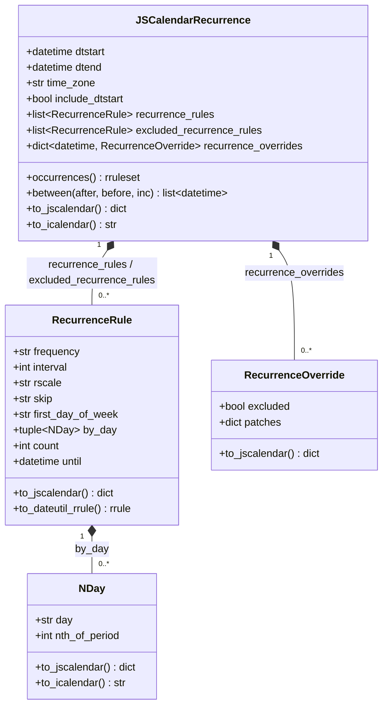

# `django_recur` API Reference

The `django_recur` package provides the native **RFC 8984 (JSCalendar)** data model, **RFC 5545 (iCalendar)** conversion and audit tools, `JSCalendarRecurrenceField`, and `<django-recur-widget>`.

## Data Model Overview

## RFC 8984 Data Model (`django_recur.rfc8984`)

### `Frequency` (`str, Enum`)

Enumeration of RFC 8984 §4.3.3 recurrence frequencies:

- `Frequency.YEARLY = "yearly"`
- `Frequency.MONTHLY = "monthly"`
- `Frequency.WEEKLY = "weekly"`
- `Frequency.DAILY = "daily"`
- `Frequency.HOURLY = "hourly"`
- `Frequency.MINUTELY = "minutely"`
- `Frequency.SECONDLY = "secondly"`

Helper methods:

- `Frequency.from_int(value: int) -> Frequency`: Convert a legacy `recurrence` / `dateutil` integer (`0..6`) to a `Frequency`.
- `freq.to_int() -> int`: Convert to a legacy `recurrence` / `dateutil` integer (`0..6`).

### `DayOfWeek` (`str, Enum`)

Enumeration of RFC 8984 §4.3.3 weekday identifiers:

- `DayOfWeek.MO = "mo"`
- `DayOfWeek.TU = "tu"`
- `DayOfWeek.WE = "we"`
- `DayOfWeek.TH = "th"`
- `DayOfWeek.FR = "fr"`
- `DayOfWeek.SA = "sa"`
- `DayOfWeek.SU = "su"`

Helper methods:

- `DayOfWeek.from_int(value: int) -> DayOfWeek`: Convert weekday index (`0..6`) to `DayOfWeek`.
- `day.to_int() -> int`: Convert `DayOfWeek` to weekday index (`0..6`).

### `Skip` (`str, Enum`)

Enumeration of RFC 8984 §4.3.3 invalid-date skip strategies:

- `Skip.OMIT = "omit"` (default)
- `Skip.BACKWARD = "backward"`
- `Skip.FORWARD = "forward"`

### `NDay`

Represents an RFC 8984 `NDay` object (`{"@type": "NDay", "day": "mo", "nthOfPeriod": 1}`):

- `day: str` (`"mo"`..`"su"`)
- `nth_of_period: int | None = None` (`-53..53`, non-zero)
- `to_jscalendar(include_type: bool = True) -> dict[str, Any]`
- `from_jscalendar(cls, data: Mapping[str, Any] | NDay | str | int) -> NDay`
- `to_icalendar() -> str` (e.g., `"1MO"`, `"-1FR"`, `"WE"`)
- `from_icalendar(cls, token: str | int | dateutil.rrule.weekday) -> NDay`

### `RecurrenceRule`

Represents an RFC 8984 `RecurrenceRule` object (§4.3.3):

- `frequency: str | int`
- `interval: int = 1`
- `rscale: str = "gregorian"`
- `skip: str = "omit"`
- `first_day_of_week: str | int | None = "mo"`
- `by_day: tuple[NDay, ...] = ()`
- `by_month_day: tuple[int, ...] = ()`
- `by_month: tuple[str, ...] = ()`
- `by_year_day: tuple[int, ...] = ()`
- `by_week_no: tuple[int, ...] = ()`
- `by_hour: tuple[int, ...] = ()`
- `by_minute: tuple[int, ...] = ()`
- `by_second: tuple[int, ...] = ()`
- `by_set_position: tuple[int, ...] = ()`
- `count: int | None = None`
- `until: datetime | None = None`
- `to_jscalendar(include_defaults: bool = False, *, time_zone: tzinfo | None = None) -> dict[str, Any]`
- `from_jscalendar(cls, data: Mapping[str, Any], *, time_zone: tzinfo | None = None) -> RecurrenceRule`
- `to_dateutil_rrule(dtstart: datetime | None = None, dtend: datetime | None = None, cache: bool = False)`
- `expand_with_skip(dtstart: datetime | None = None, dtend: datetime | None = None) -> list[datetime]`
- `to_text(short: bool = False) -> str`

### `RecurrenceOverride`

Represents a single entry in RFC 8984 `recurrenceOverrides`:

- `excluded: bool = False`
- `patches: dict[str, Any] = {}`
- `to_jscalendar() -> dict[str, Any]`
- `from_jscalendar(cls, data: Mapping[str, Any]) -> RecurrenceOverride`

### `JSCalendarRecurrence`

Container for RFC 8984 §4.3 recurrence properties:

- `dtstart: datetime | None = None` (also accessible via the `start` keyword/property)
- `dtend: datetime | None = None`
- `time_zone: str | None = None`
- `recurrence_rules: list[RecurrenceRule] = []` (aliased as `rrules`)
- `excluded_recurrence_rules: list[RecurrenceRule] = []` (aliased as `exrules`)
- `recurrence_overrides: dict[datetime, RecurrenceOverride] = {}` (`rdates` / `exdates` properties)
- `include_dtstart: bool = True`
- `occurrences(dtstart=None, dtend=None, cache=False) -> dateutil.rrule.rruleset`
- `between(after, before, inc=False, dtstart=None, dtend=None, cache=False) -> list[datetime]`
- `after(dt, inc=False, dtstart=None, dtend=None, cache=False) -> datetime | None`
- `before(dt, inc=False, dtstart=None, dtend=None, cache=False) -> datetime | None`
- `count(dtstart=None, dtend=None, cache=False) -> int`
- `to_jscalendar(include_defaults: bool = False) -> dict[str, Any]`
- `from_jscalendar(cls, data: Mapping[str, Any] | str, include_dtstart: bool | None = None) -> JSCalendarRecurrence`
- `to_json(include_defaults: bool = False, indent: int | None = None) -> str`
- `from_json`: alias for `from_jscalendar`
- `to_icalendar() -> str`
- `from_icalendar(cls, text: str, include_dtstart: bool = True) -> JSCalendarRecurrence`

## RFC 5545 Conversion & Audit (`django_recur.rfc5545`)

- `FEATURE_MATRIX`: Tuple of `FeatureMatrixEntry` instances describing every RFC 8984 / RFC 5545 feature and its auto-mapping status.
- `ConversionIssue`: Dataclass with `code: str`, `message: str`, and `property_name: str`.
- `ConversionReport`: Dataclass with `output: Any`, `lossless: bool`, and `issues: list[ConversionIssue]`.
- `convert_jscalendar_to_icalendar_with_report(obj, *, include_rscale=False, strict=False) -> ConversionReport`
- `convert_icalendar_to_jscalendar_with_report(text, *, include_dtstart=True, strict=False) -> ConversionReport`
- `jscalendar_to_icalendar(obj, include_rscale=False) -> str`
- `icalendar_to_jscalendar(text, include_dtstart=True) -> JSCalendarRecurrence`
- `deserialize_any(value, include_dtstart=True) -> JSCalendarRecurrence`

## Django Model & Form Fields (`django_recur.fields`, `django_recur.forms`, `django_recur.widgets`)

- `JSCalendarRecurrenceField`: Subclass of `django.db.models.JSONField` that stores RFC 8984 JSON in the database and returns `JSCalendarRecurrence` objects in Python.
- `JSCalendarRecurrenceFormField`: Django form field that accepts RFC 8984 JSON, RFC 5545 text, or `JSCalendarRecurrence` objects and returns a validated `JSCalendarRecurrence`.
- `RecurrenceWidget` / `JSCalendarRecurrenceWidget`: Renders `<django-recur-widget>` around a synced `<textarea>`.
