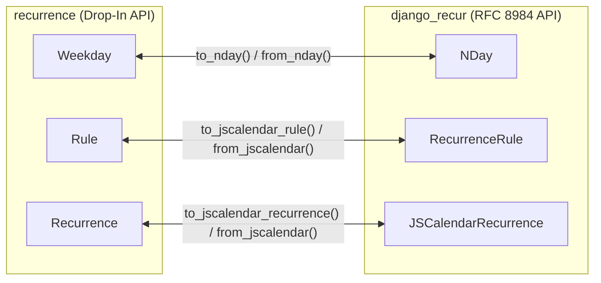

# `recurrence` Drop-In Compatibility API Reference

The `recurrence` package provides 100% drop-in compatibility with [`jazzband/django-recurrence`](https://github.com/jazzband/django-recurrence) while delegating occurrence evaluation and validation to the RFC 8984 (`django_recur`) engine.

## Compatibility Bridge

Every legacy class converts losslessly to and from its RFC 8984 counterpart:



## Core Classes (`recurrence.base`)

### `recurrence.Weekday`

Represents a weekday with an optional relative occurrence index:

- `Weekday(number: int, index: int | None = None)`
- `number`: `0` (Monday) through `6` (Sunday)
- `index`: Optional non-zero integer (`1`, `2`, `-1`, etc.)
- `weekday(index: int | None) -> Weekday`: Return a copy with `index` set (e.g., `recurrence.MO(2)` or `recurrence.FR(-1)`).
- `to_nday() -> django_recur.NDay`: Convert to an RFC 8984 `NDay` instance.
- `to_jscalendar() -> dict[str, Any]`: Convert to an RFC 8984 `NDay` dictionary.
- `from_nday(cls, nday: NDay) -> Weekday`: Construct from an RFC 8984 `NDay` instance.

Predefined constants:

- `MONDAY`, `TUESDAY`, `WEDNESDAY`, `THURSDAY`, `FRIDAY`, `SATURDAY`, `SUNDAY`
- `MO`, `TU`, `WE`, `TH`, `FR`, `SA`, `SU`

### `recurrence.Rule`

Represents an inclusion or exclusion rule (`RRULE` or `EXRULE`) backed by `django_recur.RecurrenceRule`:

```python
Rule(
    freq,
    interval=1,
    wkst=None,
    count=None,
    until=None,
    bysetpos=None,
    bymonth=None,
    bymonthday=None,
    byyearday=None,
    byweekno=None,
    byday=None,
    byhour=None,
    byminute=None,
    bysecond=None,
    rscale="gregorian",
    skip="omit",
)
```

Methods:

- `to_text(short: bool = False) -> str`
- `to_dateutil_rrule(dtstart=None, dtend=None, cache=False)`
- `to_jscalendar_rule() -> django_recur.RecurrenceRule`
- `to_jscalendar(include_defaults: bool = False) -> dict[str, Any]`
- `from_jscalendar(cls, data: Mapping[str, Any] | RecurrenceRule) -> Rule`

### `recurrence.Recurrence`

Represents a complete recurrence schedule compatible with `django-recurrence`:

```python
Recurrence(
    dtstart=None,
    dtend=None,
    rrules=(),
    exrules=(),
    rdates=(),
    exdates=(),
    include_dtstart=True,
)
```

Methods:

- `occurrences(dtstart=None, dtend=None, cache=False) -> dateutil.rrule.rruleset`
- `between(after, before, inc=False, dtstart=None, dtend=None, cache=False) -> list[datetime]`
- `after(dt, inc=False, dtstart=None, dtend=None, cache=False) -> datetime | None`
- `before(dt, inc=False, dtstart=None, dtend=None, cache=False) -> datetime | None`
- `count(dtstart=None, dtend=None, cache=False) -> int`
- `to_dateutil_rruleset(dtstart=None, dtend=None, cache=False)`
- `to_jscalendar_recurrence() -> django_recur.JSCalendarRecurrence`
- `to_jscalendar(include_defaults: bool = False) -> dict[str, Any]`
- `to_json(indent: int | None = None) -> str`
- `from_jscalendar(cls, data: Mapping[str, Any] | JSCalendarRecurrence | str, include_dtstart: bool | None = None) -> Recurrence`

## Serialization Functions (`recurrence.base`)

- `serialize(rule_or_recurrence, format: str | None = None) -> str`: Serialize a `Rule`, `Recurrence`, or `JSCalendarRecurrence` to RFC 5545 text (`format="rfc5545"`, default) or RFC 8984 JSON (`format="rfc8984"`).
- `serialize_jscalendar(rule_or_recurrence) -> dict[str, Any] | None`: Serialize a `Rule` or `Recurrence` to a JSCalendar dictionary.
- `deserialize(text, include_dtstart: bool = True) -> Recurrence`: Auto-detect and parse either RFC 5545 / RFC 2445 text or RFC 8984 JSON into a `Recurrence`.
- `to_weekday(token) -> Weekday`: Convert a `Weekday`, `NDay`, integer (`0..6`), or weekday string (`"MO"`, `"1MO"`, `"-2FR"`, `"mo"`) into a `Weekday`.
- `from_dateutil_rrule(rrule) -> Rule`
- `from_dateutil_rruleset(rruleset) -> Recurrence`

## Django Model Field & Forms (`recurrence.fields`, `recurrence.forms`, `recurrence.models`)

- `recurrence.fields.RecurrenceField(include_dtstart=True, storage_format=None, **kwargs)`: Stores recurrence rules in a database text column while transparently reading both RFC 5545 strings and RFC 8984 JSON.
- `recurrence.forms.RecurrenceField`: Form field validating and normalizing recurrence inputs.
- `recurrence.forms.RecurrenceWidget`: Progressive-enhancement Web Component widget (`<django-recur-widget>`).
- `recurrence.models.Recurrence`, `recurrence.models.Rule`, `recurrence.models.Date`, `recurrence.models.Param`: Relational models and managers (`RecurrenceManager`, `RuleManager`) preserved for legacy relational schemas.
