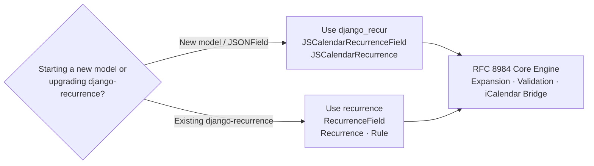

# Quickstart

## Overview

**What you will learn:**

- How to choose between the native `django_recur` API and the drop-in `recurrence` API.
- How to define a model field, create a recurrence schedule, and expand occurrences.
- How to convert schedules between RFC 8984 (JSCalendar) and RFC 5545 (iCalendar) with audit reports.

`django-recur` supports two workflows that share the same RFC 8984 core engine:



## Prerequisites

- Complete the [Installation](installation.md) steps so `"recurrence"` and `"django_recur"` are in `INSTALLED_APPS`.

## Mode 1: Native RFC 8984 API (`django_recur`)

Use `JSCalendarRecurrenceField` on new models to store schedules natively in a Django `JSONField`.

### Steps

1. Add `JSCalendarRecurrenceField` to your Django model:

   ```python
   from django.db import models
   from django_recur.fields import JSCalendarRecurrenceField


   class CalendarEvent(models.Model):
       title = models.CharField(max_length=200)
       schedule = JSCalendarRecurrenceField()
   ```

2. Build a `JSCalendarRecurrence` with rules and per-occurrence overrides, then save the model:

   ```python
   from datetime import datetime
   from django_recur import (
       DayOfWeek,
       Frequency,
       JSCalendarRecurrence,
       NDay,
       RecurrenceOverride,
       RecurrenceRule,
   )

   schedule = JSCalendarRecurrence(
       start=datetime(2026, 1, 5, 9, 0),
       recurrence_rules=[
           RecurrenceRule(
               frequency=Frequency.WEEKLY,
               interval=2,
               by_day=[NDay(day=DayOfWeek.MO), NDay(day=DayOfWeek.WE)],
               count=6,
           )
       ],
       recurrence_overrides={
           datetime(2026, 1, 19, 9, 0): RecurrenceOverride(excluded=True),
           datetime(2026, 1, 22, 9, 0): RecurrenceOverride(
               patches={"title": "Rescheduled Session"}
           ),
       },
   )

   event = CalendarEvent.objects.create(title="Architecture Sync", schedule=schedule)
   ```

3. Expand occurrences inside a date window:

   ```python
   occurrences = event.schedule.between(
       datetime(2026, 1, 1),
       datetime(2026, 3, 1),
       inc=True,
   )
   ```

4. Convert between RFC 8984 JSON and RFC 5545 iCalendar text, and inspect conversion fidelity:

   ```python
   from django_recur import convert_jscalendar_to_icalendar_with_report

   # Export RFC 5545 iCalendar text
   ical_text = schedule.to_icalendar()

   # Parse RFC 5545 text back into JSCalendarRecurrence
   parsed = JSCalendarRecurrence.from_icalendar(ical_text)

   # Audit conversion fidelity with a ConversionReport
   report = convert_jscalendar_to_icalendar_with_report(schedule)
   print(report.output)
   print(report.lossless, report.issues)
   ```

### Expected Outcome

`event.schedule` returns a `JSCalendarRecurrence` instance backed by canonical RFC 8984 JSON in the database. `occurrences` contains the expanded `datetime` values with January 19 excluded and January 22 included.

## Mode 2: Drop-In Compatibility API (`recurrence`)

Use `recurrence` when upgrading an existing `jazzband/django-recurrence` codebase without changing imports or model definitions.

### Steps

1. Keep your existing model field and imports unchanged:

   ```python
   from datetime import datetime
   from django.db import models
   import recurrence
   from recurrence.fields import RecurrenceField


   class Course(models.Model):
       title = models.CharField(max_length=200)
       recurrences = RecurrenceField()
   ```

2. Create rules, expand occurrences, and bridge to RFC 8984 whenever needed:

   ```python
   rule = recurrence.Rule(
       recurrence.WEEKLY,
       interval=1,
       byday=[recurrence.MO, recurrence.FR],
   )
   pattern = recurrence.Recurrence(
       dtstart=datetime(2026, 1, 1),
       dtend=datetime(2026, 1, 31),
       rrules=[rule],
       exdates=[datetime(2026, 1, 9)],
   )

   # Expand occurrences
   dates = list(pattern.occurrences())

   # Convert directly between legacy Recurrence and RFC 8984 JSCalendarRecurrence
   jscal = pattern.to_jscalendar_recurrence()
   roundtripped = recurrence.Recurrence.from_jscalendar(jscal)
   ```

### Expected Outcome

`dates` yields every Monday and Friday in January 2026 except January 9, and `roundtripped` equals `pattern`.

## Troubleshooting

| Symptom | Cause | Fix |
| --- | --- | --- |
| `TypeError: can't compare offset-naive and offset-aware datetimes` | Mixed naive and timezone-aware `datetime` objects in `start`, `until`, or `between()`. | Pass consistent naive or timezone-aware datetimes, or align `RECURRENCE_USE_TZ` with `settings.USE_TZ`. |
| `UnsupportedFeatureError` during occurrence expansion | The rule uses a non-Gregorian `rscale`, `by_second=[60]`, or unsupported filters with `skip`. | Restrict `skip` expansion to Gregorian `by_month` and `by_month_day` filters. |
