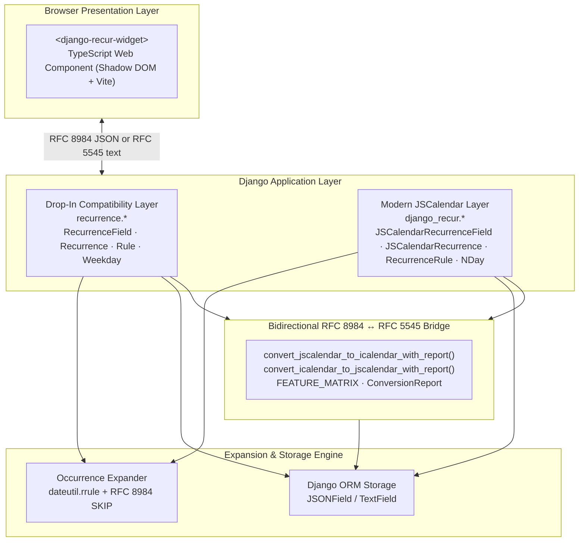

# django-recur

**`django-recur`** is a modern reimplementation of [`jazzband/django-recurrence`](https://github.com/jazzband/django-recurrence) for Django, including Django 6.1 on Python 3.12 or later.

It replaces legacy RFC 2445 text handling and jQuery widgets with an **[RFC 8984 (JSCalendar)](https://datatracker.ietf.org/doc/html/rfc8984)** engine and a TypeScript Web Component. The package ships **two co-existing namespaces** in a single distribution:

- **`django_recur`**: The native RFC 8984 (JSCalendar) engine, `JSCalendarRecurrenceField` (backed by `JSONField`), bidirectional **RFC 8984 ↔ RFC 5545** converters with audit reports, and the `migrate_recurrences` command.
- **`recurrence`**: A 100% drop-in compatible layer for `django-recurrence`. It preserves every class, constant, method, form field, and migration path while delegating evaluation to the RFC 8984 engine.

## Key Capabilities

- **RFC 8984 Core Engine**: First-class dataclasses (`JSCalendarRecurrence`, `RecurrenceRule`, `NDay`, `RecurrenceOverride`) implement RFC 8984 §4.3 validation and occurrence expansion, including `rscale` and `skip` (`omit`, `backward`, `forward`).
- **Auditable iCalendar Interoperability**: Convert between RFC 8984 JSON and RFC 5545 / RFC 2445 text with structured `ConversionReport` diagnostics. See the [RFC 8984 & RFC 5545 Matrix](rfc-compliance-matrix.md).
- **Drop-In Replacement**: Keep existing `import recurrence` and `RecurrenceField` code unchanged. `RecurrenceField` transparently reads both legacy RFC 2445/5545 text and RFC 8984 JSON.
- **Zero-Downtime Data Migration**: Run `python manage.py migrate_recurrences` with `--dry-run`, `--model`, `--batch-size`, `--strict`, and `--json` to convert stored database rows.
- **TypeScript Web Component Widget**: `<django-recur-widget>` uses Custom Elements v1 and Shadow DOM. It supports Django Admin light/dark themes, dynamic inline formsets, and both RFC 8984 JSON and RFC 5545 output modes.

## Architecture Overview

Every layer of `django-recur` converges on the RFC 8984 data model and bidirectional iCalendar bridge:

## Where to Go Next

- **[Installation](installation.md)**: Install `django-recur` with `uv` or `pip` and configure `INSTALLED_APPS`.
- **[Quickstart](getting-started.md)**: Build schedules with either `django_recur` or the drop-in `recurrence` API.
- **[RFC 8984 & RFC 5545 Matrix](rfc-compliance-matrix.md)**: Inspect feature coverage and auto-mapping rules.
- **[Migration Guide](migration-guide.md)**: Upgrade existing `django-recurrence` projects in three stages.
- **[TypeScript Web Component Widget](widget.md)**: Customize `<django-recur-widget>` and build frontend assets.
- **[API Reference](api/django-recur.md)**: Browse the `django_recur` and `recurrence` Python APIs.
