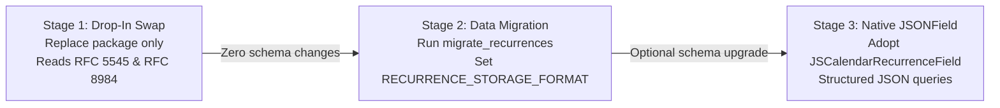

# Migration Guide (`django-recurrence` → `django-recur`)

## Overview

**What you will learn:**

- How to swap `django-recurrence` for `django-recur` with zero model changes.
- How to audit and migrate stored database rows to RFC 8984 JSON using `migrate_recurrences`.
- How to adopt native `JSCalendarRecurrenceField` (`JSONField`) for new or migrated columns.

`django-recur` supports a **three-stage zero-downtime upgrade** so you can adopt RFC 8984 at your own pace:



## Prerequisites

- A working backup of your database before running Stage 2 in production.
- Access to run Django management commands (`python manage.py ...`).

## Stage 1: Drop-In Package Replacement

Swap the dependency without changing any model fields, imports, or database rows.

1. Replace `django-recurrence` with `django-recur`:

   ```bash
   uv remove django-recurrence
   uv add django-recur
   ```

2. Add `"django_recur"` alongside `"recurrence"` in `INSTALLED_APPS`:

   ```python
   INSTALLED_APPS = [
       # ...
       "recurrence",
       "django_recur",
   ]
   ```

3. Run your existing test suite to verify drop-in behavior.

No schema migrations are needed in Stage 1. `recurrence.fields.RecurrenceField` transparently reads:

- Legacy RFC 2445 / RFC 5545 strings (`RRULE:FREQ=WEEKLY;BYDAY=MO,WE`).
- RFC 8984 JSCalendar JSON strings (`{"@type": "Event", ...}`).
- Python `recurrence.Recurrence`, `recurrence.Rule`, `django_recur.JSCalendarRecurrence`, or `dict` values.

## Stage 2: Migrate Stored Rows to RFC 8984 (`migrate_recurrences`)

Convert legacy RFC 2445 / RFC 5545 strings stored in `RecurrenceField` columns into canonical RFC 8984 JSON.

1. Run a dry run first to audit every field and row without modifying the database:

   ```bash
   python manage.py migrate_recurrences --dry-run
   ```

2. Pass `--json` to produce a machine-readable report for CI/CD logs:

   ```bash
   python manage.py migrate_recurrences --dry-run --json
   ```

   Example JSON report:

   ```json
   {
     "target_format": "rfc8984",
     "dry_run": true,
     "fields_inspected": 1,
     "scanned": 142,
     "migrated": 140,
     "already_target_format": 2,
     "conversion_warnings": 0,
     "warning_details": [],
     "skipped_empty": 0,
     "errors": 0,
     "error_details": []
   }
   ```

3. Execute the migration across all models, or scope it to one model or field with `--model`:

   ```bash
   # Migrate all models with RecurrenceField or JSCalendarRecurrenceField
   python manage.py migrate_recurrences

   # Migrate a specific model or field
   python manage.py migrate_recurrences --model events.Course.schedule
   ```

4. Switch the default write format in `settings.py` so all future saves write RFC 8984 JSON:

   ```python
   RECURRENCE_STORAGE_FORMAT = "rfc8984"
   ```

### Expected Outcome

Re-running `python manage.py migrate_recurrences --dry-run` reports `"migrated": 0` and `"errors": 0`, with all populated rows counted under `"already_target_format"`.

### Command-Line Options Reference

| Option | Default | Description |
| --- | --- | --- |
| `--model <label>` | All models | Restrict migration to `app_label.ModelName` or `app_label.ModelName.field_name`. |
| `--dry-run` | `False` | Parse, convert, and validate all rows without writing to the database. |
| `--target-format` | `"rfc8984"` | Use `"rfc5545"` to roll back legacy text fields. All-model rollbacks skip native JSON fields; targeting a native JSON field explicitly returns an error. |
| `--batch-size` | `500` | Number of rows processed per database batch. |
| `--include-defaults` | `False` | Include default RFC 8984 values (`interval: 1`, `rscale: "gregorian"`, etc.) in JSON output. |
| `--strict` | `False` | Abort on any parse error or lossy conversion. A failed field rolls back its own writes. |
| `--json` | `False` | Output a structured JSON summary report. |

The command skips lossy imports and reports them as errors. A rollback without `--strict` reports any lossy exports as warnings.

## Stage 3: Adopt `JSCalendarRecurrenceField` (Optional)

For new models—or when converting text columns to native PostgreSQL/SQLite `JSONField`—use `django_recur.fields.JSCalendarRecurrenceField`:

```python
from django.db import models
from django_recur.fields import JSCalendarRecurrenceField


class Event(models.Model):
    recurrences = JSCalendarRecurrenceField()
```

`JSCalendarRecurrenceField` subclasses `django.db.models.JSONField`. It stores structured JSON natively in the database and returns `JSCalendarRecurrence` instances in Python.

## Troubleshooting

| Symptom | Cause | Fix |
| --- | --- | --- |
| Non-zero `errors` in `--dry-run` output | One or more rows contain malformed iCalendar text or lossy imports. | Inspect `error_details` in `--dry-run --json`, fix the source rows, and re-run. |
| Rollback with `--target-format rfc5545` fails on a model | The targeted field is a native `JSCalendarRecurrenceField` (`JSONField`). | Target only legacy `RecurrenceField` columns when rolling back to `"rfc5545"`. |
| Migration aborted mid-field under `--strict` | A row triggered a conversion warning or parse error. | Re-run with `--dry-run --json` to inspect `warning_details`, then resolve or omit `--strict`. |
