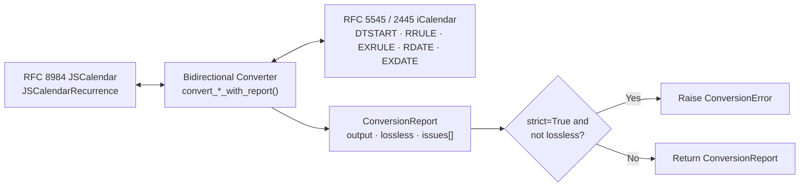

# RFC 8984 & RFC 5545 Feature & Auto-Mapping Matrix

## Overview

**What you will learn:**

- How `django-recur` maps recurrence properties between RFC 8984 (JSCalendar) and RFC 5545 / RFC 2445 (iCalendar).
- How `ConversionReport` classifies lossless, conditional, lossy, and unsupported mappings.
- How to audit conversions programmatically at runtime.

`django-recur` provides transparent, auditable interoperability between:

- **RFC 8984 (JSCalendar)** — §4.3 (*Recurrence Properties*: `recurrenceRules`, `excludedRecurrenceRules`, `recurrenceOverrides`, `excluded`) and the `RecurrenceRule` / `NDay` data types.
- **RFC 5545 (iCalendar)** — together with legacy **RFC 2445** (`EXRULE`) and **RFC 7529** (`RSCALE` / `SKIP` extensions).



## Scope & Date-Time Limits

The converters handle recurrence properties for a single schedule. Full calendar components, custom `VTIMEZONE` definitions, and detached override events with `RECURRENCE-ID` require a full calendar parser. Named zones resolve against the IANA timezone database available to Python or the browser.

JSCalendar writes `start`, `until`, and recurrence IDs as wall-clock times with `timeZone` carrying the zone (including `"UTC"`). The Python reader still accepts older values with a `Z` suffix. Floating times have no zone. At a daylight-saving overlap, an unqualified local time uses the first occurrence, and a nonexistent local time uses the pre-transition offset when converted to UTC. Converting the later occurrence of an overlap to a JSCalendar local time is reported as lossy.

The Python converter reports `DATE`-only values promoted to midnight and fractional seconds discarded by iCalendar. Python and JavaScript preserve `BYSECOND=60` in rules, while explicit leap-second timestamps and Python occurrence expansion for rules containing second `60` are unsupported.

Gregorian monthly and yearly `SKIP` expansion supports `by_month` and `by_month_day` filters. Other filter combinations raise `UnsupportedFeatureError`. Non-Gregorian calendar scales can be serialized and converted.

## Auto-Mapping Classifications

Both this matrix and `django_recur.rfc5545.FEATURE_MATRIX` classify every mapping into four levels:

| Classification | Meaning | Behavior in `strict=False` (Default) | Behavior in `strict=True` |
| --- | --- | --- | --- |
| **`lossless`** | 1:1 semantic and structural equivalence between RFC 8984 and RFC 5545. | Automatically mapped without warnings. | Automatically mapped without errors. |
| **`conditional`** | Lossless for standard values; requires an extension (RFC 7529 `RSCALE`/`SKIP` or RFC 2445 `EXRULE`) or value normalization for non-default inputs. | Automatically mapped; records an informational or warning `ConversionIssue` when non-standard values are used. | Raises `ConversionError` if a lossy fallback is triggered. |
| **`lossy`** | One specification is strictly richer than the other (for example, RFC 8984 `recurrenceOverrides` with per-occurrence property patches like `{"title": "Moved"}` mapped to flat `RDATE`). | Maps the recurrence timestamp (`RDATE`) and records a lossy `ConversionIssue` in `ConversionReport`. | Raises `ConversionError`. |
| **`unsupported`** | Not part of the recurrence specification. | Recorded in `ConversionReport`. | Raises `ConversionError`. |

## Master Feature & Auto-Mapping Matrix

### 1. Top-Level Recurrence Container Properties

| Feature / Concept | RFC 8984 (JSCalendar §4.3) | RFC 5545 / RFC 2445 (iCalendar) | Implemented | Auto-Map: `8984 → 5545` | Auto-Map: `5545 → 8984` | Notes & Edge Cases |
| --- | --- | --- | --- | --- | --- | --- |
| **Start Date/Time** | `start` (`LocalDateTime`) with optional `timeZone` | `DTSTART` (`DATE-TIME` / `DATE`) | Yes | **Conditional** | **Conditional** | IANA `TZID`, UTC, and floating date-times are supported. See [Scope & Date-Time Limits](#scope-date-time-limits). |
| **End / Bound Date/Time** | `dtend` (compatibility extension) | `DTEND` (`DATE-TIME` / `DATE`) | Yes | **Conditional** | **Conditional** | Carried as a recurrence bound with the same date-time rules as `DTSTART`. |
| **Inclusion Rules** | `recurrenceRules: RecurrenceRule[]` | Multiple `RRULE:` lines | Yes | **Yes (`lossless`)** | **Yes (`lossless`)** | Preserves rule ordering across multiple rules. |
| **Exclusion Rules** | `excludedRecurrenceRules: RecurrenceRule[]` | `EXRULE:` lines (RFC 2445; deprecated in RFC 5545) | Yes | **Yes (`conditional`)** | **Yes (`lossless`)** | RFC 8984 natively reinstated `excludedRecurrenceRules`. Export emits `EXRULE:` lines and logs a `ConversionIssue`. |
| **Additional Inclusion Dates** | `recurrenceOverrides: { "<LocalDateTime>": {} }` | `RDATE:` lines | Yes | **Yes (`lossless` for empty patch, `lossy` for property patches)** | **Yes (`lossless`)** | An empty override `{}` maps losslessly to `RDATE` and back. |
| **Excluded Dates** | `recurrenceOverrides: { "<LocalDateTime>": { "excluded": true } }` | `EXDATE:` lines | Yes | **Yes (`lossless`)** | **Yes (`lossless`)** | Maps `{"excluded": true}` directly to `EXDATE` and back. |
| **Per-Occurrence Property Patches** | `recurrenceOverrides: { "<LocalDateTime>": { "title": "...", "duration": "..." } }` | Separate `VEVENT` component with `RECURRENCE-ID` | Yes (in RFC 8984 model) | **Partial (`lossy` in single-rule string)** | N/A | A standalone rule string cannot hold multiple `VEVENT` components; property patches degrade to `RDATE` with a lossy `ConversionIssue`. |

### 2. `RecurrenceRule` / `RRULE` Parts

| Rule Part | RFC 8984 (`RecurrenceRule`) | RFC 5545 (`RRULE` / `EXRULE`) | Implemented | Auto-Map: `8984 → 5545` | Auto-Map: `5545 → 8984` | Notes & Edge Cases |
| --- | --- | --- | --- | --- | --- | --- |
| **Object Type** | `@type: "RecurrenceRule"` | Implicit in `RRULE:` / `EXRULE:` | Yes | **Yes (`lossless`)** | **Yes (`lossless`)** | Validated on JSON deserialization; defaults to `"RecurrenceRule"`. |
| **Frequency** | `frequency`: `"yearly"` \| `"monthly"` \| `"weekly"` \| `"daily"` \| `"hourly"` \| `"minutely"` \| `"secondly"` | `FREQ=YEARLY\|MONTHLY\|WEEKLY\|DAILY\|HOURLY\|MINUTELY\|SECONDLY` | Yes | **Yes (`lossless`)** | **Yes (`lossless`)** | Case-normalized 1:1 mapping across lowercase RFC 8984 strings, uppercase RFC 5545 tokens, and `recurrence` integer constants (`0..6`). |
| **Interval** | `interval` (`UnsignedInt >= 1`, default `1`) | `INTERVAL=<int>` | Yes | **Yes (`lossless`)** | **Yes (`lossless`)** | Default `1` is omitted in compact JSON unless `include_defaults=True`. |
| **Calendar Scale** | `rscale` (`String`, default `"gregorian"`) | `RSCALE=<scale>` (RFC 7529 extension) | Yes | **Yes (`conditional`)** | **Yes (`lossless`)** | Default `"gregorian"` is lossless. Non-Gregorian scales emit `RSCALE=` when `include_rscale=True` and record a `ConversionIssue`. |
| **Invalid Date Skip Behavior** | `skip`: `"omit"` (default) \| `"backward"` \| `"forward"` | `SKIP=OMIT\|BACKWARD\|FORWARD` (RFC 7529 extension) | Yes | **Yes (`conditional`)** | **Yes (`lossless`)** | Natively expands `skip="backward"` (Feb 29 → Feb 28) and `skip="forward"` (Feb 29 → Mar 1). Pass `include_rscale=True` to emit `SKIP=` in RFC 5545 text. |
| **First Day of Week** | `firstDayOfWeek`: `"mo"`..`"su"` (default `"mo"`) | `WKST=MO\|TU\|WE\|TH\|FR\|SA\|SU` | Yes | **Yes (`lossless`)** | **Yes (`lossless`)** | Bidirectional 1:1 mapping with `recurrence.Weekday` and integer weekday indices (`0..6`). |
| **By Day (`NDay`)** | `byDay: NDay[]` (`{"@type": "NDay", "day": "mo", "nthOfPeriod": 1}`) | `BYDAY=1MO,-1FR,WE` | Yes | **Yes (`lossless`)** | **Yes (`lossless`)** | Bidirectional conversion between `NDay`, RFC 5545 `[±n]WKDAY` tokens, and `recurrence.Weekday`. |
| **By Month** | `byMonth: String[]` (`"1".."12"`, or `"5L"` for leap months) | `BYMONTH=1,2,...,12` (`5L` requires RFC 7529) | Yes | **Yes (`conditional`)** | **Yes (`lossless`)** | Standard months `"1"`–`"12"` map 1:1. Leap-month strings ending in `"L"` require RFC 7529 `RSCALE`. |
| **By Month Day** | `byMonthDay: Int[]` (`-31..-1`, `1..31`) | `BYMONTHDAY=-31..-1,1..31` | Yes | **Yes (`lossless`)** | **Yes (`lossless`)** | Excludes `0` and out-of-range integers per RFC 8984 §4.3.3 and RFC 5545 §3.3.10. |
| **By Year Day** | `byYearDay: Int[]` (`-366..-1`, `1..366`) | `BYYEARDAY=-366..-1,1..366` | Yes | **Yes (`lossless`)** | **Yes (`lossless`)** | Excludes `0` and values outside `±366`. |
| **By Week Number** | `byWeekNo: Int[]` (`-53..-1`, `1..53`) | `BYWEEKNO=-53..-1,1..53` | Yes | **Yes (`lossless`)** | **Yes (`lossless`)** | Excludes `0` and values outside `±53`. |
| **By Hour** | `byHour: UnsignedInt[]` (`0..23`) | `BYHOUR=0..23` | Yes | **Yes (`lossless`)** | **Yes (`lossless`)** | Validated in `0..23`. |
| **By Minute** | `byMinute: UnsignedInt[]` (`0..59`) | `BYMINUTE=0..59` | Yes | **Yes (`lossless`)** | **Yes (`lossless`)** | Validated in `0..59`. |
| **By Second** | `bySecond: UnsignedInt[]` (`0..60`) | `BYSECOND=0..60` | Yes | **Yes (`lossless`)** | **Yes (`lossless`)** | Includes leap second `60` per both RFCs. |
| **By Set Position** | `bySetPosition: Int[]` (`-366..-1`, `1..366`) | `BYSETPOS=-366..-1,1..366` | Yes | **Yes (`lossless`)** | **Yes (`lossless`)** | Filters candidate occurrences within each period before `count` or `until`. |
| **Count Limit** | `count: UnsignedInt` (`>= 1`) | `COUNT=<int>` | Yes | **Yes (`lossless`)** | **Yes (`lossless`)** | Mutually exclusive with `until` / `UNTIL` in both RFCs. |
| **Until Limit** | `until: LocalDateTime` | `UNTIL=<DATE-TIME \| DATE>` | Yes | **Conditional** | **Conditional** | Named zones use UTC for iCalendar `UNTIL`. Converting back to local time can lose the distinction between repeated wall-clock times. |

## Programmatic Access to the Matrix & Conversion Reports

Inspect the feature matrix or audit any conversion at runtime using `django_recur.rfc5545`:

```python
from django_recur.rfc5545 import (
    FEATURE_MATRIX,
    convert_jscalendar_to_icalendar_with_report,
)
from django_recur.rfc8984 import Frequency, JSCalendarRecurrence, RecurrenceRule, Skip

# 1. Inspect the programmatic feature matrix
for entry in FEATURE_MATRIX:
    print(f"{entry.feature_id}: {entry.auto_mapping}")

# 2. Audit an RFC 8984 -> RFC 5545 conversion
rec = JSCalendarRecurrence(
    recurrence_rules=[
        RecurrenceRule(
            frequency=Frequency.YEARLY,
            by_month=["2"],
            by_month_day=[29],
            skip=Skip.BACKWARD,
        )
    ]
)
report = convert_jscalendar_to_icalendar_with_report(rec)
print(report.output)
# RRULE:FREQ=YEARLY;BYMONTH=2;BYMONTHDAY=29
print(report.lossless, report.issues)
# Default export reports that SKIP was dropped. Pass include_rscale=True to retain it.
```
