# TypeScript Web Component Widget (`<django-recur-widget>`)

## Overview

**What you will learn:**

- How `<django-recur-widget>` progressively enhances a standard Django `<textarea>`.
- How to attach the widget to Django forms and listen for `django-recur:change` events.
- How to theme the widget with CSS custom properties and build the frontend bundle.

`django-recur` replaces the legacy prototype-based JavaScript widget from `django-recurrence` with a zero-dependency **Custom Element (`<django-recur-widget>`)** authored in strict TypeScript and bundled with Vite.

## Architecture & Runtime Flow

```mermaid
sequenceDiagram
    participant Django as Django Form / Admin
    participant CE as <django-recur-widget>
    participant Shadow as Shadow DOM UI
    participant TA as Hidden <textarea>

    Django->>CE: Render wrapper + initial value (RFC 8984 or RFC 5545)
    CE->>TA: Read initial value
    CE->>Shadow: Attach open Shadow DOM & render rule/date builder
    Note over Shadow: User edits rules, NDay chips, skip strategy, or dates
    Shadow->>CE: Update internal JSCalendar state
    CE->>TA: Sync serialized value (data-output-format)
    CE-->>Django: Dispatch bubbling "django-recur:change" CustomEvent
```

Both `recurrence.forms.RecurrenceWidget` and `django_recur.widgets.JSCalendarRecurrenceWidget` render a standard `<textarea class="recurrence-widget">` wrapped inside `<django-recur-widget data-output-format="...">`:



Key capabilities of the widget:

- **Encapsulated Shadow DOM UI**: Upgrades automatically when `recurrence-widget.js` loads, hides the underlying `<textarea>`, and renders an accessible interactive builder.
- **Inclusion & Exclusion Rules**: Edit `recurrenceRules` and `excludedRecurrenceRules` with frequency (`yearly` through `secondly`), interval, weekday chips (`mo`–`su`), relative `NDay` (`nthOfPeriod`), `byMonthDay`, `byMonth`, RFC 8984 `skip` strategy (`omit`, `backward`, `forward`), and `count` or `until` bounds.
- **Inclusion & Exclusion Dates**: Add one-off `recurrenceOverrides` (`RDATE` / `EXDATE`) with an interactive date picker.
- **Live Summary & Inspector**: Displays a human-readable summary alongside a collapsible RFC 8984 JSON / RFC 5545 `RRULE` inspector.
- **Dual Output Serialization**: Emits RFC 5545 text when `data-output-format="rfc5545"` (default for `RecurrenceWidget`) or RFC 8984 JSON when `data-output-format="rfc8984"` (default for `JSCalendarRecurrenceWidget`). Both modes parse either format on load.

## Using the Widget in Django Forms & Admin

The widget attaches automatically to `RecurrenceField` and `JSCalendarRecurrenceField`. To customize it on a standalone form:

1. Configure `JSCalendarRecurrenceWidget` on your form field:

   ```python
   from django import forms
   from django_recur.forms import JSCalendarRecurrenceFormField
   from django_recur.widgets import JSCalendarRecurrenceWidget


   class EventForm(forms.Form):
       schedule = JSCalendarRecurrenceFormField(
           widget=JSCalendarRecurrenceWidget(attrs={"class": "custom-schedule"})
       )
   ```

2. Include `{{ form.media }}` in templates outside the Django Admin:

   ```html
   {{ form.media }}
   <form method="post">
       
       {{ form.as_p }}
       <button type="submit">Save</button>
   </form>
   ```

## Custom Events & DOM API

`<django-recur-widget>` dispatches a bubbling, composed `CustomEvent` named `django-recur:change` whenever rules or overrides change:

```javascript
document.addEventListener("django-recur:change", (event) => {
    console.log("RFC 8984 JSCalendar state:", event.detail.jscalendar);
    console.log("Serialized form value:", event.detail.serialized);
});
```

Read or update the widget state programmatically in JavaScript or TypeScript:

```javascript
const widget = document.querySelector("django-recur-widget");

// Read the current RFC 8984 schedule object
const state = widget.value;

// Update the widget state programmatically
widget.value = {
    "@type": "Event",
    recurrenceRules: [
        {
            "@type": "RecurrenceRule",
            frequency: "weekly",
            interval: 1,
            byDay: [{ "@type": "NDay", day: "mo" }, { "@type": "NDay", day: "fr" }],
        },
    ],
};
```

## Styling & Dark Mode

`<django-recur-widget>` inherits Django Admin CSS variables (`--body-bg`, `--body-fg`, `--border-color`, `--primary`, `--delete-button-bg`) automatically. Override the dedicated custom properties to apply a custom theme:

```css
django-recur-widget {
    --django-recur-bg: #ffffff;
    --django-recur-fg: #1f2937;
    --django-recur-border: #d1d5db;
    --django-recur-primary: #2563eb;
    --django-recur-danger: #dc2626;
    --django-recur-muted: #6b7280;
    --django-recur-card-bg: #f9fafb;
}
```

## Building and Testing the Frontend Pipeline

The TypeScript source lives in `frontend/`:

1. Install Node dependencies:

   ```bash
   cd frontend
   npm install
   ```

2. Run typechecking, unit tests, and the production Vite build:

   ```bash
   npm run typecheck
   npm test
   npm run build
   ```

`npm run build` outputs the production bundle to `src/recurrence/static/recurrence/js/recurrence-widget.js`.

## Troubleshooting

| Symptom | Cause | Fix |
| --- | --- | --- |
| Widget stays as a plain `<textarea>` | `{{ form.media }}` is omitted or static files are not served. | Add `{{ form.media }}` to the template and verify `recurrence-widget.js` loads in browser DevTools. |
| Inline Django Admin formset rows do not upgrade | Older custom JS prevented `MutationObserver` or `formset:added` handling. | Ensure `recurrence-widget.js` is loaded once on the page; `<django-recur-widget>` upgrades newly inserted rows automatically. |
